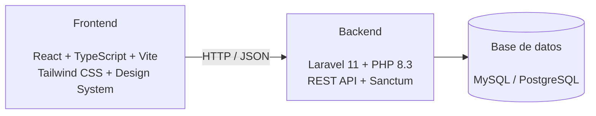

# Juarex Project Commercial Web

Frontend de la **Plataforma web de administración de proyectos, tickets, cotizaciones y seguimiento comercial**.

La aplicación es una SPA desarrollada con React y TypeScript, diseñada para consumir la API REST independiente del proyecto backend.

## Descripción

El sistema tiene como objetivo centralizar la gestión de clientes, proyectos, tareas, tickets, cotizaciones, reuniones y seguimiento comercial, proporcionando interfaces diferenciadas según el rol del usuario.

El frontend se desarrolla como una aplicación independiente del backend y se comunica con este mediante una API REST.

## Estado actual

El proyecto se encuentra en desarrollo incremental.

Actualmente se encuentran implementados:

- Arquitectura base de la aplicación.
- Entorno de desarrollo con Docker y Dev Container.
- Configuración de React + TypeScript + Vite.
- Configuración de ESLint y Prettier.
- Enrutamiento con React Router.
- Autenticación mediante Laravel Sanctum.
- Gestión de sesión y usuario autenticado.
- Rutas protegidas y rutas para usuarios invitados.
- Integración con la API REST del backend.
- Design System inicial.
- Componentes UI reutilizables.
- Playground para validación visual de componentes.
- Pruebas unitarias y de componentes.
- Integración del Design System en la pantalla de inicio de sesión.

Los módulos funcionales restantes se implementarán progresivamente de acuerdo con el roadmap del proyecto.

## Tecnologías

### Frontend

- React 18
- TypeScript
- Vite
- React Router
- TanStack Query
- Zustand
- React Hook Form
- Zod
- Axios

### UI y Design System

- Tailwind CSS 4
- shadcn/ui
- Radix UI
- Lucide React
- Class Variance Authority

### Testing y calidad

- Vitest
- Testing Library
- MSW
- ESLint
- Prettier
- TypeScript

### Infraestructura de desarrollo

- Docker
- Docker Compose
- Dev Containers
- Node.js 24

## Arquitectura

El proyecto utiliza una organización basada principalmente en funcionalidades (`features`) y componentes reutilizables.

```text
src/
├── app/
│   ├── providers/
│   └── router/
├── assets/
├── components/
│   ├── shared/
│   └── ui/
├── config/
├── dev/
│   └── playground/
├── features/
│   └── auth/
├── hooks/
├── lib/
├── services/
│   └── api/
├── stores/
├── test/
├── types/
├── utils/
├── App.tsx
├── index.css
└── main.tsx
```

### `app/`

Configuración global de la aplicación, incluyendo providers y enrutamiento.

### `components/ui/`

Componentes reutilizables pertenecientes al Design System.

Actualmente incluye componentes como:

- Button
- Input
- Textarea
- Label
- Card
- Badge
- Select
- Checkbox
- Switch
- Field
- Separator

Los componentes cuentan con pruebas cuando corresponde.

### `features/`

Organización de funcionalidades del sistema.

Actualmente se encuentra implementado el feature de autenticación:

```text
features/
└── auth/
    ├── components/
    ├── pages/
    ├── schemas/
    ├── services/
    ├── stores/
    └── types/
```

Los futuros módulos se incorporarán progresivamente bajo esta misma organización.

### `services/api/`

Configuración y utilidades para la comunicación con la API REST.

### `dev/playground/`

Página de desarrollo utilizada para visualizar y validar los componentes del Design System.

Está disponible en:

```text
/playground
```

## Design System

El proyecto utiliza un Design System propio basado en Tailwind CSS y shadcn/ui.

Los tokens principales se encuentran definidos en:

```text
src/index.css
```

Actualmente se han definido tokens para:

- colores;
- superficies;
- tipografía base;
- estados de feedback;
- bordes;
- inputs;
- focus;
- cards;
- popovers;
- radios;
- sombras.

El objetivo es mantener una interfaz consistente y reutilizable a medida que se incorporan nuevos módulos.

Los componentes UI se mantienen dentro del proyecto para permitir su adaptación a las necesidades específicas de la aplicación.

## Autenticación

La autenticación utiliza **Laravel Sanctum mediante cookies de sesión**, sin almacenar JWT en el frontend.

El flujo principal contempla:

```text
Frontend
   │
   ├── Solicitud CSRF
   │
   ├── Inicio de sesión
   │
   ├── Consulta del usuario autenticado
   │
   └── Cierre de sesión
   │
   ▼
Backend Laravel API
```

Las rutas principales actualmente son:

```text
GET  /sanctum/csrf-cookie
POST /api/v1/auth/login
POST /api/v1/auth/logout
GET  /api/v1/auth/me
```

Las rutas de la aplicación también contemplan:

- rutas para usuarios invitados;
- rutas protegidas;
- redirección al dashboard después del inicio de sesión;
- manejo de sesiones no autorizadas.

## Configuración del entorno

La aplicación utiliza variables de entorno para configurar la conexión con el backend.

Archivo de referencia:

```text
.env.example
```

Variables principales:

```env
WEB_PORT=5173
VITE_API_URL=http://localhost:8000
```

El archivo `.env` local no debe incluirse en el repositorio.

Por ejemplo, para un backend ejecutándose en el puerto `8040`:

```env
WEB_PORT=5173
VITE_API_URL=http://localhost:8040
```

## Desarrollo con Docker

El proyecto está preparado para ejecutarse mediante Docker Compose.

Construir e iniciar el entorno:

```bash
docker compose up --build
```

Para iniciar los servicios utilizando las imágenes existentes:

```bash
docker compose up
```

La aplicación estará disponible en:

```text
http://localhost:5173
```

El entorno utiliza un volumen para el código fuente y un volumen independiente para `node_modules`.

Debido al uso de Docker Desktop con bind mounts en Windows, Vite utiliza polling para garantizar correctamente la detección de cambios y el Hot Module Replacement (HMR).

## Dev Container

El proyecto también incluye configuración para trabajar directamente desde un Dev Container.

Configuración:

```text
.devcontainer/devcontainer.json
```

Extensiones principales configuradas:

- Prettier
- ESLint
- Tailwind CSS IntelliSense

El workspace del proyecto dentro del contenedor utiliza:

```text
/app
```

## Scripts disponibles

### Desarrollo

```bash
npm run dev
```

Inicia el servidor de desarrollo de Vite.

### Build

```bash
npm run build
```

Realiza el typecheck y genera el build de producción.

### Preview

```bash
npm run preview
```

Sirve localmente el build generado.

### Lint

```bash
npm run lint
```

Ejecuta ESLint.

### Corrección automática de ESLint

```bash
npm run lint:fix
```

Corrige automáticamente los problemas que ESLint pueda resolver.

### Formateo

```bash
npm run format
```

Formatea los archivos utilizando Prettier.

### Verificación de formato

```bash
npm run format:check
```

Comprueba que los archivos estén correctamente formateados sin modificarlos.

### Typecheck

```bash
npm run typecheck
```

Ejecuta la comprobación de tipos de TypeScript.

### Tests

```bash
npm run test
```

Ejecuta las pruebas una vez.

Para ejecutar las pruebas en modo watch:

```bash
npm run test:watch
```

### Verificación completa

```bash
npm run check
```

Ejecuta todas las verificaciones principales:

```text
format:check
    ↓
typecheck
    ↓
lint
    ↓
test
    ↓
build
```

Este comando debe utilizarse como validación antes de realizar commits importantes.

## Control de versiones

El proyecto utiliza Git con una estrategia basada en ramas de funcionalidad.

Las funcionalidades se desarrollan en ramas independientes y posteriormente se integran en `develop`.

Ejemplo:

```text
main
 │
 └── develop
      │
      ├── feature/frontend-foundation
      ├── feature/application-foundation
      ├── feature/authentication
      └── feature/design-system
```

Los commits siguen la convención **Conventional Commits**.

Ejemplos:

```text
feat(auth): implement authentication flow
feat(ui): establish design system
build(docker): pin Composer image to version
chore(frontend): configure code quality tooling
```

## Roadmap

El desarrollo del frontend seguirá progresivamente las fases definidas para el proyecto.

### Fase 0 — Fundación

- Arquitectura base.
- Configuración del entorno.
- Autenticación.
- Roles y permisos.
- Clientes.

### Fase 1 — Gestión operativa

- Proyectos.
- Tareas.
- Kanban.
- Gantt.
- Tickets.
- Portal del cliente.

### Fase 2 — Gestión comercial

- Cotizaciones.
- Reuniones.
- Calendario.

### Fase 3 — Seguimiento y estrategia

- Dashboard.
- Objetivos.
- KPI.
- OKR.
- Plan estratégico.
- Reportes.

### Fase 4 — Gestión administrativa

- Facturación.
- Presupuestos.
- Recursos humanos.
- Contratos.
- Riesgos.

Las funcionalidades se incorporarán progresivamente conforme avance el desarrollo del sistema.

## Relación con el backend

Este repositorio contiene exclusivamente el frontend.

El backend se desarrolla como un proyecto independiente mediante una API REST construida con Laravel.

La comunicación entre ambos proyectos se realiza mediante HTTP/JSON.



## Requisitos

Para trabajar con el proyecto se recomienda disponer de:

- Docker Desktop.
- Visual Studio Code.
- Extensión Dev Containers de Visual Studio Code.
- Git.

El desarrollo principal se realiza dentro del entorno Docker/Dev Container para mantener consistencia entre entornos.

---

**Juarex Project Commercial Web**
Plataforma web de administración de proyectos, tickets, cotizaciones y seguimiento comercial.
